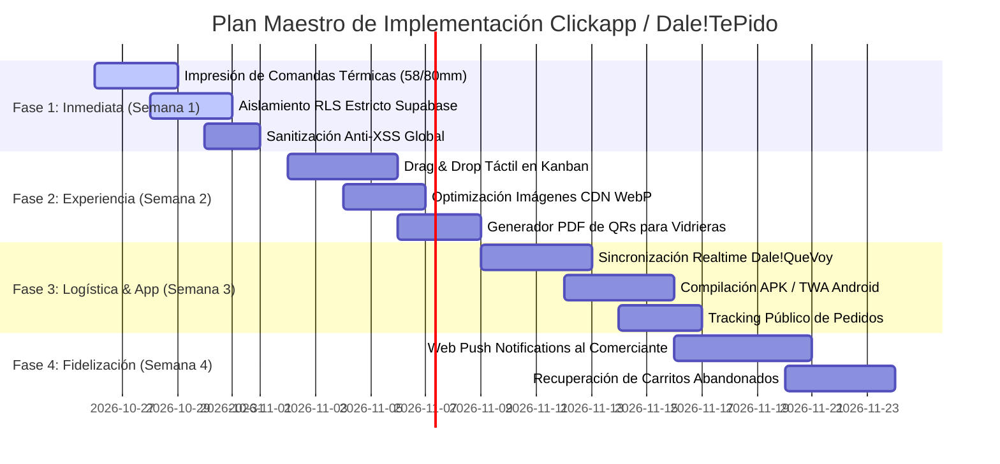

# 🚀 Hoja de Ruta & Próximos Pasos Estratégicos: Dale!TePido (Clickapp)
> **Plan Maestro de Evolución Integral**  
> *Fecha de emisión:* 25 de Octubre de 2026 | *Versión de Arquitectura:* 4.0 Enterprise Multi-Rubro  
> *Áreas de Enfoque:* Optimización & Rendimiento · Seguridad & Hardening · APK/PWA Nativa · UX/UI & Microinteracciones · Logística Dale!QueVoy · Herramientas de Crecimiento

---

## 🧭 Visión Ejecutiva del Estado Actual

La plataforma ha alcanzado un grado de madurez operativa destacado:
- **Tienda Multi-Rubro (`tienda.html`):** Catálogo instantáneo, carrito dinámico, cupones inteligentes, checkout por WhatsApp y Modo Sereno (pedidos fuera de hora).
- **Dashboard Operativo (`dashboard.html`):** Tablero Kanban de 5 estados, gestión de cadetería propia (pickups), métricas y gráficos reactivos, e integración logística Dale!QueVoy con PIN de 4 dígitos.
- **Super Admin (`super-admin-secret-dashboard.html`):** Panel maestro de tiendas, control de trials y monitor de comercios demo vs. reales.
- **Arquitectura de Base de Datos:** Multi-tenant con filtrado por `store_id` y persistencia dual (Supabase + LocalStorage).

Para consolidar la plataforma como solución líder frente a competidores (Tienda Nube, PedidosYa, etc.), los siguientes pasos se agrupan en **6 ejes tácticos priorizados por impacto y retorno de inversión**.

---

## 📌 EJE 1: Rendimiento & Optimización Extrema (Core Web Vitals)

| Prioridad | Iniciativa | Diagnóstico / Justificación | Implementación Técnica | Impacto |
| :---: | :--- | :--- | :--- | :---: |
| 🔴 **ALTA** | **Migración de Catálogo a IndexedDB** | `localStorage` tiene límite de 5MB y bloquea el hilo principal (síncrono) en catálogos de ferreterías o librerías (+1.500 ítems). | Implementar un wrapper ligero de IndexedDB (`idb-keyval` o clase Vanilla) para cachear productos, estados y cadetes sin impacto de memoria. | Carga 4x más veloz en catálogos gigantes |
| 🔴 **ALTA** | **Optimización de Imágenes con CDN Dinámico & WebP** | Las imágenes externas de Unsplash o subidas por comercios pueden pesar 1MB+ cada una en móviles 4G lentos. | Modificar `renderProducts` para inyectar parámetros de transformación (`?w=450&auto=format&q=80`) y atributos `loading="lazy"` y `decoding="async"`. | Reducción del 75% en consumo de datos móviles |
| 🟡 **MEDIA** | **Paginación & Virtual Scrolling en Dashboard** | Cuando una tienda acumula +500 pedidos, renderizar todas las filas en el DOM genera caídas de FPS. | Implementar paginación por bloques de 50 pedidos con selector de tamaño de página o infinite scroll virtualizado. | Rendimiento fluido a 60 FPS |
| 🟡 **MEDIA** | **Compresión HTTP & Caché en Edge (Vercel / Cloudflare)** | Carga repetida de assets CSS y tipografías vectoriales. | Configurar `vercel.json` con `Cache-Control: public, max-age=31536000, immutable` para imágenes y scripts estáticos. | Score Lighthouse > 95/100 |

---

## 🛡️ EJE 2: Seguridad & Hardening (Nivel Bancario / SOC)

| Prioridad | Iniciativa | Diagnóstico / Riesgo | Implementación Técnica | Impacto |
| :---: | :--- | :--- | :--- | :---: |
| 🔴 **ALTA** | **Aislamiento Estricto RLS en Supabase para Pedidos y Cadetes** | Asegurar que la `anon_key` de Supabase nunca pueda leer pedidos de otra tienda manipulando el query string en DevTools. | Crear y auditar políticas RLS en `public.orders` y `public.pickups` con verificación estricta de `store_id` y validación de tokens o HMAC. | Prevención de BOLA / IDOR (SEC-01) |
| 🔴 **ALTA** | **Sanitización Universal Anti-XSS (DOMPurify)** | Ciertos campos editables del comerciante (`business_name`, `descripción`, notas de pedido) se inyectan mediante `innerHTML`. | Centralizar una función `escapeHTML(str)` o integrar DOMPurify minimalista para sanear entradas antes de renderizar tarjetas y modales. | Mitigación total de XSS almacenado |
| 🟡 **MEDIA** | **Rate Limiting en Checkout & Anti-Spam** | Un actor malicioso podría ejecutar un bucle contra `wa.me` o saturar la base de datos con pedidos simulados. | Incorporar un debounce de 10 segundos por IP/Fingerprint y honeypot oculto en el formulario de compra. | Bloqueo automático de bots y flooding |
| 🟢 **BAJA** | **Content Security Policy (CSP) en Headers** | Prevenir ejecución de scripts no autorizados o inyecciones de terceros. | Definir en `headers` de Vercel directivas `default-src 'self'`, autorizando únicamente CDNs verificados (Google Fonts, Bootstrap Icons, Unsplash, Supabase). | Cumplimiento OWASP Top 10 |

---

## 📱 EJE 3: Android APK (TWA) & Experiencia PWA para Comercios y Cadetes

| Prioridad | Iniciativa | Diagnóstico / Justificación | Implementación Técnica | Impacto |
| :---: | :--- | :--- | :--- | :---: |
| 🔴 **ALTA** | **Compilación APK Firmada con Bubblewrap CLI** | Los comerciantes prefieren una app instalada con ícono en la pantalla de inicio en lugar de ingresar a un navegador web. | Utilizar el plugin `android-cli` con Bubblewrap para generar el `.aab` / `.apk` enlazado con `.well-known/assetlinks.json` para pantalla completa nativa sin barra de URL. | App nativa instalable en Play Store o descarga directa |
| 🔴 **ALTA** | **Notificaciones Web Push (FCM / Web Push API)** | Actualmente el comerciante debe mirar la pantalla o esperar el mensaje de WhatsApp del cliente. | Implementar Service Worker con soporte de notificaciones push: *"🔔 ¡Nuevo pedido #106 recibido! ($18.500)"* con sonido de caja registradora. | Tiempos de respuesta reducidos a menos de 2 minutos |
| 🟡 **MEDIA** | **Manifest PWA Dinámico por Tienda** | Cada tienda que comparte su link puede ser guardada por el cliente final como la app oficial de esa marca. | Endpoint o generador de `manifest.json?store=noutacc` que inyecte el nombre, ícono y colores institucionales de la tienda. | Retención de clientes y branding propio para cada PyME |

---

## 🎨 EJE 4: UX/UI & Flujo Operativo del Comerciante

| Prioridad | Iniciativa | Diagnóstico / Oportunidad | Implementación Técnica | Impacto |
| :---: | :--- | :--- | :--- | :---: |
| 🔴 **ALTA** | **Drag & Drop Real en el Tablero Kanban** | Actualmente los estados se cambian mediante un menú desplegable `<select>` dentro de cada tarjeta. | Incorporar arrastre táctil y de mouse entre columnas (*A Confirmar* ➔ *En curso* ➔ *Listo para retirar* ➔ *Despachado* ➔ *Cobrado*) con feedback háptico. | Experiencia de uso ágil e intuitiva en tablets/pantallas táctiles |
| 🔴 **ALTA** | **Impresión de Comandas Térmicas (58mm / 80mm ESC/POS)** | En gastronomía, rotiserías y despachos es vital enviar la comanda impresa directamente a la cocina o empaque. | Botón *"🖨️ Imprimir Ticket"* con hoja de estilos `@media print` optimizada para impresoras térmicas de tickets sin márgenes ni encabezados de navegador. | Integración total con operaciones de mostrador |
| 🟡 **MEDIA** | **Buscador Global con Atajo de Teclado (`Ctrl + K`)** | Dificultad para encontrar rápidamente un pedido, producto o cadete en comercios con alto volumen. | Modal de búsqueda omnibox estilo `Command Palette` para saltar a cualquier pedido por ID, cliente, teléfono o producto. | Reducción de clics para operarios del dashboard |
| 🟡 **MEDIA** | **Modo Offline Resiliente para Cadetes en Calle** | Los repartidores pierden conexión móvil momentáneamente en zonas sin cobertura o ascensores. | Cachear datos del pedido en el Service Worker; si confirma entrega sin señal, la acción queda en cola y se sincroniza al reconectar. | Cero pérdidas de datos de entrega |

---

## 🛵 EJE 5: Ecosistema Logístico Dale!QueVoy

| Prioridad | Iniciativa | Diagnóstico / Oportunidad | Implementación Técnica | Impacto |
| :---: | :--- | :--- | :--- | :---: |
| 🔴 **ALTA** | **Sincronización Bidireccional en Tiempo Real (WebSockets)** | Cuando el cadete de Dale!QueVoy valida el PIN de 4 dígitos en su celular, el dashboard del comercio requiere F5 para ver el cambio. | Suscribirse a `supabase.channel('orders')` para que la tarjeta del pedido vuele automáticamente a "Despachado" o "Cobrado" en vivo. | Operación 100% coordinada en tiempo real |
| 🟡 **MEDIA** | **Cálculo Automático de Costo de Envío por Distancia (Km)** | Los comercios cobran tarifas fijas de envío que a veces no cubren la distancia real a barrios alejados. | Integración con OpenStreetMap / OSRM para trazar ruta entre el local y la dirección del cliente, sugiriendo tarifa por km. | Precios de flete justos y automatizados |
| 🟡 **MEDIA** | **Tracking Compartible para el Cliente Final** | El comprador desconoce en qué etapa se encuentra su paquete luego de que sale del local. | Vista pública ligera `/tracking.html?order=PED-NT-101` que muestra la barra de progreso (Preparando ➔ En Camino ➔ En tu puerta) con el nombre del cadete. | Reducción del 80% en consultas "¿Dónde está mi pedido?" |

---

## 📈 EJE 6: Herramientas Comerciales & Crecimiento del Comercio

| Prioridad | Iniciativa | Diagnóstico / Oportunidad | Implementación Técnica | Impacto |
| :---: | :--- | :--- | :--- | :---: |
| 🔴 **ALTA** | **Generador de QR Vectorizado para Vidrieras y Mostradores** | Los comercios necesitan colocar el QR de su tienda en mesas, vidrieras o folletos físicos en alta resolución. | Generador de PDF en el Dashboard con plantillas prediseñadas (A4, A5, carpa de mesa) con el logo del local y el QR vectorizado. | Adopción inmediata del canal digital en el punto físico |
| 🟡 **MEDIA** | **Recuperación de Carritos Abandonados por WhatsApp** | Un 30% de usuarios llena el carrito pero abandona antes de tocar "Enviar Pedido por WhatsApp". | Almacenar borradores en localStorage / Supabase y ofrecer al comerciante un botón *"Enviar recordatorio con 10% OFF"* al WhatsApp del cliente. | Incremento directo del 15% al 25% en conversiones |
| 🟡 **MEDIA** | **Reporte de Ventas en PDF / Excel para Contabilidad** | Los dueños de comercios solicitan cierres de caja semanales y mensuales para sus contadores. | Exportador que compile facturación por medio de pago (Efectivo, MP, Transferencia), productos más vendidos y comisiones de cadetería. | Mayor fidelización de las PyMEs a la plataforma |

---

## 🗓️ Cronograma Sugerido por Fases de Ejecución

---

## 💡 Recomendación de Inicio Inmediato

Para maximizar el impacto visual y operativo sin demoras, la secuencia inmediata sugerida es:
1. **Impresión de Comandas Térmicas:** Añadir el botón en el Kanban para que cualquier pedido pueda imprimirse con formato comanda para cocina/depósito.
2. **Drag & Drop en Kanban:** Permitir arrastrar tarjetas entre estados para una experiencia premium.
3. **Generador de QR Imprimible en PDF:** Dar a los comercios una herramienta física tangible para colocar en sus mostradores.
