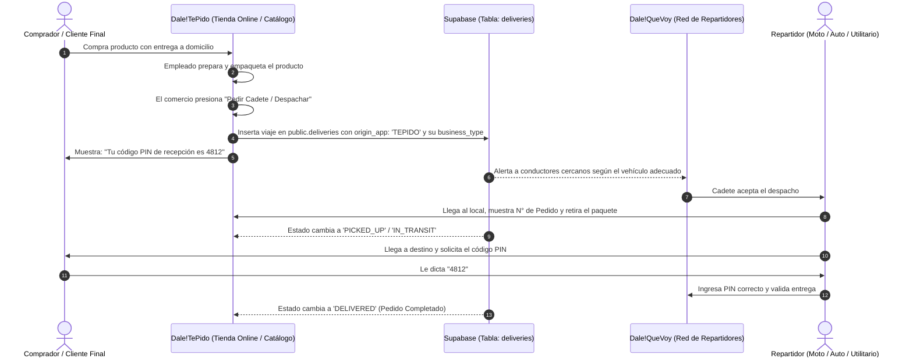

# 🌐 Contexto de Integración Multi-Rubro: Dale!TePido 🤝 Dale!QueVoy

> **Documento de Contexto y Especificación Técnica Universal para Dale!TePido (Clickapp)**  
> *Este documento explica cómo funciona el ecosistema para **TODOS LOS RUBROS COMERCIALES** (Farmacias, Ferreterías, Tiendas de Ropa, Pet Shops, Almacenes, Vinotecas, E-commerce, Gastronomía y más), y cómo se conectan los pickups con la red de cadetes de Dale!QueVoy en tiempo real.*

---

## 1. Visión del Ecosistema Multi-Rubro

El ecosistema **"Dale!"** NO se limita a la gastronomía. Es una solución de comercio y logística abierta para **cualquier tienda, local barrial, PyME o e-commerce**:

| Plataforma | Función Principal | Rol en la Operación |
| :--- | :--- | :--- |
| **Dale! Te Pido** *(Clickapp)* | Catálogo digital, tienda online autogestionada, QR para mostrador/vidriera y sistema de pedidos directo por WhatsApp / Web sin comisiones por venta. | **El Comercio / La Tienda** (Vende el producto) |
| **Dale! Que Voy** | Red multimodal de repartidores (Bicicleta, Moto, Auto, Camioneta / Van utilitaria) con verificación de identidad KYC, entrega segura por PIN y trazabilidad en tiempo real. | **La Flota Logística On-Demand** (Retira y Entrega) |

---

## 2. Los Rubros Contemplados y sus Modos de Envío

Dale!QueVoy adapta el vehículo según el tamaño, peso y rubro del paquete vendido en Dale!TePido:

```
┌──────────────────────────────┬─────────────────────────────┬───────────────────────────────┐
│ RUBRO EN DALE!TEPIDO         │ TIPO DE PAQUETE             │ VEHÍCULO ÓPTIMO EN DALE!QUEVOY│
├──────────────────────────────┼─────────────────────────────┼───────────────────────────────┤
│ 💊 Farmacia & Cosmética      │ Medicamentos, cremas, perf. │ 🚴 Bicicleta / 🛵 Moto Exprés │
│ 👗 Ropa, Calzado & Retail    │ Bolsas indumentaria, zapat. │ 🛵 Moto / 🚗 Auto             │
│ 🔧 Ferretería & Corralón     │ Herramientas, pintura, mat. │ 🚗 Auto / 🚐 Camioneta (Van)  │
│ 🐾 Pet Shop & Mascotas       │ Bolsas alimento 15-20 kg    │ 🚗 Auto / 🚐 Utilitario       │
│ 🥫 Almacén, Kiosco & Bebidas │ Packs de bebidas, víveres   │ 🛵 Moto / 🚗 Auto             │
│ 📦 E-commerce & Electrónica  │ Repuestos, gadgets, libros  │ 🛵 Moto / 🚗 Auto             │
│ 🍽️ Gastronomía & Cafetería   │ Comida lista en bolsa térm. │ 🚴 Bici / 🛵 Moto             │
└──────────────────────────────┴─────────────────────────────┴───────────────────────────────┘
```

### Ventajas para Cualquier Tipo de Comercio:
1. **0% Comisión sobre la venta:** El local cobra el 100% de su mercadería.
2. **Cero costos fijos de logística:** Un comercio no necesita comprar una camioneta ni pagarle un sueldo fijo a un cadete que está parado esperando pedidos. Solicita el flete en Dale!QueVoy únicamente cuando tiene un paquete listo.
3. **Flota Multimodal:** Desde una moto para un remedio urgente en 10 minutos, hasta un utilitario para latas de pintura o bolsas de cemento de 50 kg.
4. **Seguridad y Control PIN:** El comprador final recibe un código PIN de 4 números. El cadete solo puede marcar "Entregado" cuando el cliente le dicta el PIN.

---

## 3. El Flujo de Pickup Universal (Paso a Paso)



---

## 4. Configuración de Base de Datos Compartida (Supabase)

Ambas aplicaciones utilizan el mismo proyecto central de Supabase:
- **Supabase URL:** `https://ppqfvnexetuwldovpjlq.supabase.co`
- **Tabla Destino:** `public.deliveries`

### Columnas a enviar desde Dale!TePido:

| Columna | Tipo | Valores / Descripción |
| :--- | :--- | :--- |
| `id` | `UUID` | ID único del despacho (`crypto.randomUUID()`) |
| `origin_app` | `TEXT` | **Siempre `'TEPIDO'`** |
| `requester_id` | `UUID` / `TEXT` | ID del comercio en Dale!TePido |
| `title` | `TEXT` | Nombre del local y N° de pedido (ej. `"Ferretería El Candado — #TP-3041"`) |
| `description` | `TEXT` | Contenido del paquete (ej. `"Caja con amoladora y discos. Peso aprox 8kg."`) |
| `category` | `TEXT` | `'PHARMACY'`, `'HARDWARE'`, `'RETAIL'`, `'PETSHOP'`, `'FOOD'`, `'SMALL_BOX'`, `'LARGE_CARGO'` |
| `weight_kg` | `NUMERIC` | Peso real o estimado del paquete en kg |
| `origin_address` | `TEXT` | Dirección del local (punto de retiro / pickup) |
| `origin_lat` / `origin_lng` | `NUMERIC` | Coordenadas GPS del local |
| `destination_address` | `TEXT` | Dirección de entrega del cliente |
| `destination_lat` / `destination_lng` | `NUMERIC` | Coordenadas GPS del cliente |
| `offered_price_ars` | `NUMERIC` | Tarifa pactada del envío a abonar al transportista |
| `pin_code` | `VARCHAR(4)` | **Código aleatorio de 4 dígitos** para validar la entrega |
| `customer_phone` | `TEXT` | Teléfono/WhatsApp del cliente para que el cadete avise al llegar |
| `status` | `TEXT` | `'SEARCHING'` |

---

## 5. Código de Integración para Dale!TePido (Cualquier Rubro)

Implementado en `js/logistics.js` (`window.DaleLogistics`):

```javascript
import { createClient } from '@supabase/supabase-js';

const supabase = createClient(
  process.env.VITE_SUPABASE_URL || 'https://ppqfvnexetuwldovpjlq.supabase.co',
  process.env.VITE_SUPABASE_ANON_KEY
);

/**
 * Despacha un pedido de cualquier rubro comercial a Dale!QueVoy
 * @param {Object} order - Datos de la orden en Dale!TePido
 * @param {('PHARMACY'|'HARDWARE'|'RETAIL'|'PETSHOP'|'GROCERY'|'FOOD'|'ECOMMERCE'|'OTHER')} businessType
 */
export async function despacharEnvioDaleQueVoy(order, businessType = 'OTHER') {
  // 1. Generar código de seguridad de 4 dígitos para el cliente
  const pinCode = Math.floor(1000 + Math.random() * 9000).toString();

  // 2. Mapear categoría adecuada según el rubro y peso
  let category = 'SMALL_BOX';
  if (businessType === 'PHARMACY') category = 'PHARMACY';
  else if (businessType === 'HARDWARE' || (order.pesoKg && order.pesoKg > 15)) category = 'LARGE_CARGO';
  else if (businessType === 'PETSHOP') category = 'PETSHOP';
  else if (businessType === 'RETAIL') category = 'RETAIL';
  else if (businessType === 'GASTRONOMY') category = 'FOOD';

  // 3. Crear el viaje en Supabase
  const { data, error } = await supabase
    .from('deliveries')
    .insert({
      id: crypto.randomUUID(),
      origin_app: 'TEPIDO',
      requester_id: order.comercioId,
      title: `${order.comercioNombre} — #${order.numeroPedido}`,
      description: `${order.resumenProductos} (${order.bultos || 1} bulto/s)`,
      category: category,
      weight_kg: order.pesoKg || 2.0,
      origin_address: order.comercioDireccion,
      origin_lat: order.comercioLat,
      origin_lng: order.comercioLng,
      destination_address: order.clienteDireccion,
      destination_lat: order.clienteLat,
      destination_lng: order.clienteLng,
      offered_price_ars: order.costoEnvioARS,
      est_distance_km: order.distanciaKm || 3.5,
      pin_code: pinCode,
      status: 'SEARCHING',
      customer_phone: order.clienteTelefono
    })
    .select()
    .single();

  if (error) {
    console.error('Error al despachar a Dale!QueVoy:', error);
    throw error;
  }

  return {
    deliveryId: data.id,
    pinCode: pinCode
  };
}

/**
 * Escucha cambios de estado del cadete en tiempo real
 */
export function escucharEstadoCadete(deliveryId, onUpdate) {
  const channel = supabase
    .channel(`pickup_${deliveryId}`)
    .on(
      'postgres_changes',
      {
        event: 'UPDATE',
        schema: 'public',
        table: 'deliveries',
        filter: `id=eq.${deliveryId}`
      },
      payload => onUpdate(payload.new)
    )
    .subscribe();

  return () => supabase.removeChannel(channel);
}
```

---

## 6. Adaptaciones en la UI de Dale!TePido

1. **En el Panel del Comercio / Dashboard (`dashboard.html`):**
   - Cuando entra una venta con entrega a domicilio (sea una farmacia, ferretería o tienda de ropa), mostrar el botón:  
     `📦 Despachar con Dale!QueVoy`
   - El sistema avisa el vehículo sugerido (ej: *"Para este peso de 18 kg se solicitará un auto o camioneta"*).

2. **En la Tienda del Cliente (`tienda.html`):**
   - Mostrar el comprobante de envío con el PIN:
     ```
     ┌────────────────────────────────────────────────────────┐
     │ 🔒 CÓDIGO DE RECEPCIÓN: 4812                           │
     │ Mostrale este código al repartidor al recibir tu compra│
     │ para confirmar la entrega segura de tu paquete.        │
     └────────────────────────────────────────────────────────┘
     ```

3. **En el Tracking en Vivo:**
   - Muestra el estado en tiempo real:
     - 🔍 *Buscando repartidor cercano...*
     - 🚗 *Repartidor asignado en camino al local.*
     - 📦 *Paquete retirado del comercio, en viaje a tu domicilio.*
     - ✅ *¡Paquete entregado con éxito!*
