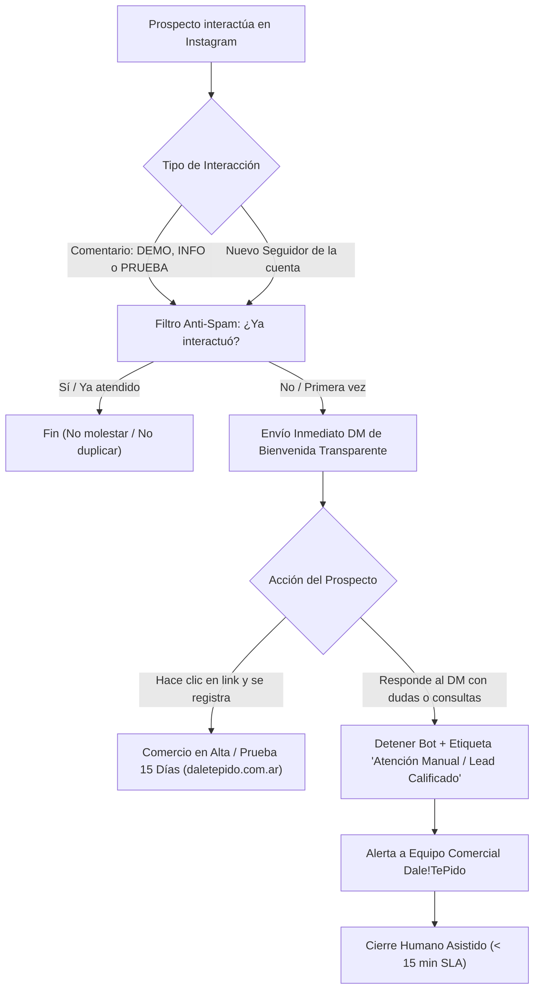

# Sistema Anti-Pérdida de Prospectos: Setup Opal & Meta DM (Instagram)

> **Objetivo:** Activar el embudo de bienvenida inmediata para capturar, orientar y derivar prospectos (leads) que interactúen con las publicaciones de Dale!TePido en Instagram, garantizando tasa de respuesta inmediata sin perder oportunidades de venta ni saturar a los usuarios.

---

## 1. Arquitectura del Embudo



---

## 2. Parámetros de Plataforma (Opal / Meta Business Suite)

| Parámetro | Configuración | Justificación Técnica & Comercial |
| :--- | :--- | :--- |
| **Herramienta** | Opal / Meta Business Suite / ManyChat | Automatización nativa aprobada por API de Meta. |
| **Triggers Principales** | 1) Nuevo seguidor de `@daletepido`<br>2) Comentario en reels/feed con palabras clave: `DEMO`, `INFO`, `PRUEBA` (sin distinción de mayúsculas). | Captura la intención activa de compra y el interés orgánico en caliente. |
| **Condición de Frecuencia** | **"Ejecutar por única vez por usuario"** (Frecuencia: 1 vez cada 30 días como máximo). | Evita spam masivo, bloqueos por políticas de Meta y fricción con usuarios recurrentes. |
| **Trigger Secundario** | El usuario responde cualquier mensaje en la conversación de DM. | Detecta conversación activa que requiere criterio humano inmediato. |
| **Acción Secundaria** | 1) Pausar/Detener automatización en ese chat.<br>2) Asignar etiqueta: `Atención Manual / Lead Calificado`. | Garantiza que ningún bot interfiera cuando un humano está dispuesto a interactuar. |

---

## 3. Prompt Oficial de Configuración para Opal

```text
Objetivo: Crear automatización de bienvenida y captura de prospectos en Instagram DM con derivación humana.

- Trigger Principal: 
  Cuando un usuario sigue a @daletepido o comenta en cualquier posteo/reel las palabras DEMO, INFO o PRUEBA.

- Condición Anti-Spam:
  Ejecutar únicamente una sola vez por usuario. No reenviar si ya existe un hilo de conversación previo.

- Acción 1 (DM Inmediato):
  Enviar este mensaje exacto (mantener tono cercano, honesto y transparente):

"¡Hola! 👋 Gracias por conectar con nosotros. (Te somos súper transparentes: este es un mensaje automático rápido para darte la bienvenida a Dale!TePido 🤖).

Nuestro propósito es que los comercios locales vendan por internet sin perder margen: 
✅ 0% comisiones por venta.
✅ Catálogo online listo en 5 minutos (chau pantalla en blanco).
✅ Comandas impecables directo a tu WhatsApp.

Podés activar tus 15 días de prueba gratis desde el link de nuestra bio o directamente acá: https://daletepido.com.ar

Si tenés dudas, ¡respondé este mensaje y una persona de nuestro equipo te escribe en minutos!"

- Trigger Secundario: 
  Si el usuario responde al mensaje o envía cualquier consulta.

- Acción 2: 
  Detener la automatización inmediatamente y asignar la etiqueta "Atención Manual / Lead Calificado" en la bandeja de entrada para derivación al equipo comercial.
```

---

## 4. Protocolo Operativo y SLA de Cierre Humano

1. **Monitoreo Diario de la Bandeja:**
   - Horario pico comercial (10:00 a 14:00 y 18:00 a 22:00 hs).
   - Filtrar en Meta Business Suite por la etiqueta **`Atención Manual / Lead Calificado`**.
2. **SLA de Respuesta:**
   - Tiempo de primera respuesta humana: **menor a 15 minutos**.
3. **Guión de Contacto Rápido Humano:**
   > *"¡Hola [Nombre]! Acá [Tu Nombre] de Dale!TePido. Vi que nos escribiste 🙌 ¿Qué tipo de negocio tenés (gastronomía, indumentaria, fiambrería, etc.)? Así te muestro exactamente cómo armar tu catálogo o te paso una demo lista de tu rubro."*
4. **Vínculo con Super Admin Prospectos:**
   - Si el cliente solicita llamada o demo asistida, cargar su registro en `/super-admin-prospectos.html` para seguimiento y despacho de mails personalizados.

---

## 5. Control de Calidad y Políticas de Meta
- **Enlace directo limpio:** Se utiliza `https://daletepido.com.ar` sin redirecciones intermedias de Google ni parámetros sospechosos, asegurando alta entregabilidad.
- **Transparencia proactiva:** Se declara expresamente la naturaleza automatizada del primer mensaje, fortaleciendo la confianza de marca y cumpliendo con las políticas de mensajería responsable de Meta.
